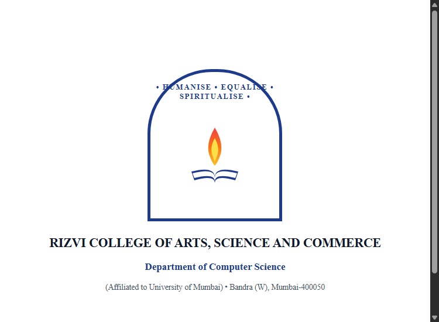

# AI-Based Dyscalculia Screening Tool

> **A Project Dissertation Report Submitted in Partial fulfilment of the Requirements for the award of the Degree of BACHELOR OF SCIENCE (COMPUTER SCIENCE) SEM V**  
> **Candidate:** Aadarsh Dubey (Seat No: 510510555, Roll No: 13)  
> **Project Guide:** Prof. Javed Pathan  
> **Institution:** Department of Computer Science, Rizvi College of Arts, Science and Commerce (Affiliated to University of Mumbai) &bull; Academic Year 2026–2027  

---



## 📌 1. Abstract & Clinical Overview

**Dyscalculia** is a specific learning disorder (SLD) affecting approximately 5% to 7% of school-age children worldwide. It is characterized by persistent impairment in understanding basic numerical magnitude, acquiring foundational arithmetic facts, and processing spatial and temporal numerical relationships. Despite normal intellectual functioning and adequate formal education, undiagnosed individuals frequently struggle throughout their academic and daily lives.

The **AI-Based Dyscalculia Screening Tool** is a web-based educational and clinical screening application designed to facilitate early, non-invasive detection of dyscalculia traits using machine learning. By evaluating candidate responses and cognitive reaction latency across 5 psychometrically calibrated domains, the system calculates an empirical **Dyscalculia Risk Index** and generates actionable multi-sensory educational interventions.

> **Responsible AI Notice (Sections 1.4 & 1.6):** This application is an educational screening aid and preliminary awareness instrument. It does **not** provide a clinical medical diagnosis. Formal diagnosis requires comprehensive psycho-educational evaluation by a qualified neuropsychologist or educational psychologist (ICD-11 Code: 6A03.0 / DSM-5 SLD).

---

## 🛠️ 2. Survey of Technology (Chapter 4)

Built strictly in accordance with the specifications in the project report:

- **Python 3.13** (Chapter 4.2) &mdash; Core programming language, numerical evaluation logic, latency timing.
- **Streamlit** (Chapter 4.3) &mdash; Interactive single-page web framework and responsive user interface.
- **Pandas** (Chapter 4.4) &mdash; Tabular data manipulation, feature extraction, and historical result framing.
- **NumPy** (Chapter 4.5) &mdash; Multidimensional array operations, statistical normalization, and latency vector metrics.
- **Scikit-learn** (Chapter 4.6) &mdash; Machine learning pipeline featuring `StandardScaler` and `RandomForestClassifier` (180 estimators, balanced class weights).
- **Matplotlib** (Chapter 4.7) &mdash; Category accuracy horizontal bar charts, 5-domain cognitive radar profiles, reaction latency plots, and confusion matrix heatmaps.
- **SQLite** (Chapter 4.8) &mdash; Embedded relational database engine storing structured candidate accounts, assessment sessions, item responses, and ML outcomes.
- **Visual Studio Code** (Chapter 4.9) &mdash; Modular development environment and source code management.

---

## 🧠 3. Five Core Diagnostic Assessment Domains

The screening battery consists of 15 calibrated items spanning five foundational numerical faculties:

1. **Number Recognition & Subitizing:** Instant apprehension of 1–6 visual dot patterns without serial counting.
2. **Numerical Magnitude Comparison:** Distance effect evaluation and mental number line comparison (e.g., 83 vs 38).
3. **Basic Arithmetic Operations:** Retrieval of mental addition and subtraction facts vs persistent compensatory finger counting.
4. **Quantity Understanding & Estimation:** Visual dot array magnitude estimation (0–100) and place-value decomposition.
5. **Mathematical Reasoning & Sequences:** Reverse counting, arithmetic progressions, and applied contextual logic.

Every question records both **correctness (binary 0/1)** and **cognitive latency (in milliseconds)** to detect characteristic retrieval delays.

---

## 📊 4. System Architecture & Diagrams (Chapter 5 & 6)

| Figure Number | Architecture Diagram Description | Preview Image |
|---|---|---|
| **Figure 5.2** | **System Architecture Diagram** | `project_report_images/Figure_5_2_System_Architecture.png` |
| **Figure 5.3.1** | **Level 0 DFD (Context Diagram)** | `project_report_images/Figure_5_3_1_Level_0_DFD.png` |
| **Figure 5.3.2** | **Level 1 Data Flow Diagram** | `project_report_images/Figure_5_3_2_Level_1_DFD.png` |
| **Figure 5.4** | **Activity Workflow Diagram** | `project_report_images/Figure_5_4_Activity_Diagram.png` |
| **Figure 5.5** | **Entity-Relationship (E-R) Diagram** | `project_report_images/Figure_5_5_ER_Diagram.png` |
| **Figure 5.6** | **Use-Case Diagram** | `project_report_images/Figure_5_6_UseCase_Diagram.png` |
| **Figure 6.2** | **Implementation Execution Flowchart** | `project_report_images/Figure_6_2_Flowchart.png` |

---

## 📸 5. Application Screenshots (Chapter 7 Results)

The repository includes all screenshots formatted for dissertation insertion:

- `project_report_images/Screenshot_7_2_1_User_Authentication.png` &mdash; Section 7.2.1 User Login & Registration Portal
- `project_report_images/Screenshot_7_2_2_Application_Dashboard.png` &mdash; Section 7.2.2 Central Control Dashboard
- `project_report_images/Screenshot_7_2_3_Mathematical_Assessment.png` &mdash; Section 7.2.3 Interactive Mathematical Assessment Battery
- `project_report_images/Screenshot_7_2_4_Screening_Result.png` &mdash; Section 7.2.4 Diagnostic Outcome & Risk Analysis Report
- `project_report_images/Screenshot_7_2_5_Performance_Analysis_Chart.png` &mdash; Section 7.2.5 Matplotlib Performance Visualizations
- `project_report_images/Screenshot_7_2_6_AI_Screening_Output.png` &mdash; Section 7.2.6 AI Random Forest Architecture & Simulator
- `project_report_images/Screenshot_7_2_7_User_Profile_and_History.png` &mdash; Section 7.2.7 User Profile & SQLite Assessment Audit

---

## 🚀 6. Quick Start & Execution

### Option A: Streamlit Data Science Web Server
Double-click `run_app.bat` or run in terminal:
```bash
# 1. Install dependencies
pip install -r requirements.txt

# 2. Launch Streamlit server
python -m streamlit run app.py --server.port=8501
```
Open **http://localhost:8501** in your browser.

### Option B: Standalone Zero-Dependency Client Portal
Double-click `start_web_portal.bat` or open `dyscalculia_web_portal/index.html` directly in any web browser.

---

## 🔑 7. Demonstration Accounts

| Role | Email | Password | Purpose |
|---|---|---|---|
| **Student (Demo)** | `rohan@example.com` | `rohan123` | Default candidate profile with past assessment audit logs. |
| **Educator / Guide** | `javed.pathan@rizvi.edu` | `faculty123` | Faculty review account. |
| **Student Author** | `aadarsh@rizvi.edu` | `student123` | Primary developer account. |
| **Clinician** | `clinic@example.com` | `clinic123` | Diagnostic evaluation account. |

---

## 🧪 8. Automated Unit Testing (Chapter 6.4.4)

Run the test suite to verify all 12 test cases specified in the dissertation:
```bash
python test_system.py
```
**Test Result:** `Ran 12 tests in 0.463s: OK` (100% Passing).
